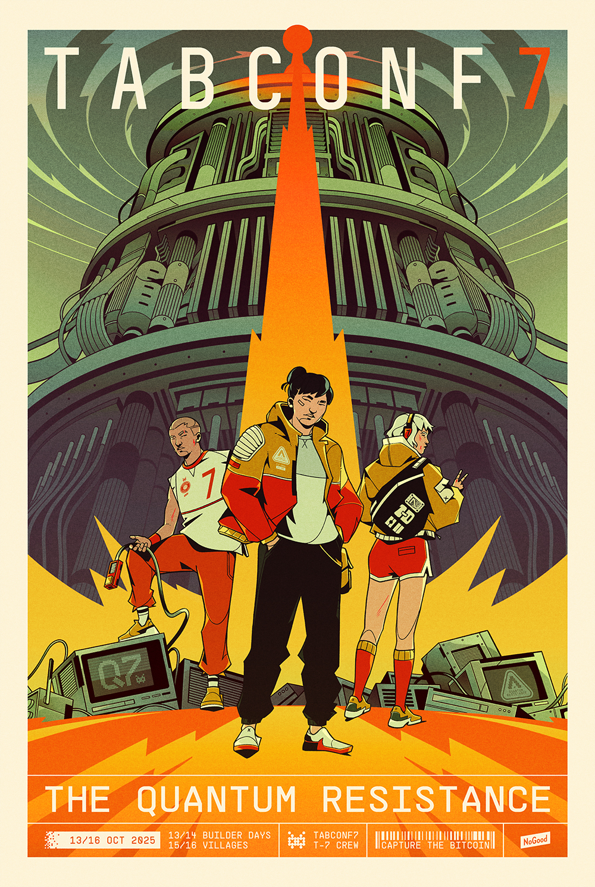

# Mission

#### TABConf's mission is to create a forum for protocol and application developers to collaborate, debate, and innovate on Bitcoin.

<a target="_blank" href="https://checkout.opennode.com/p/7d51f71f-f3e6-4159-bbfa-3a231d14e5b8" class="button button1 button4">TABConf 8 Tickets (Pay with BTC)</a>

***

## TABConf 
- **T**echnical
- **A**ccessible 
- **B**itcoin
- **C**ommunity
- **O**pen source
- **N**ovel
- **F**un

At TABConf, we bring together the best and brightest minds in the bitcoin world to share their insights, knowledge, and experience about the latest developments. From seasoned core devs to up-and-coming plebs.

Don't miss out on your chance to be a part of TABConf 7. Join us in Atlanta, and we will make some magic happen! 🤘
Read about our [history](./history.md) at TABConf. 

*** 

869693
